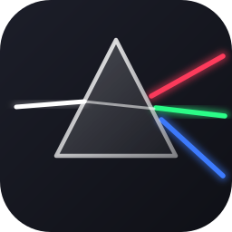
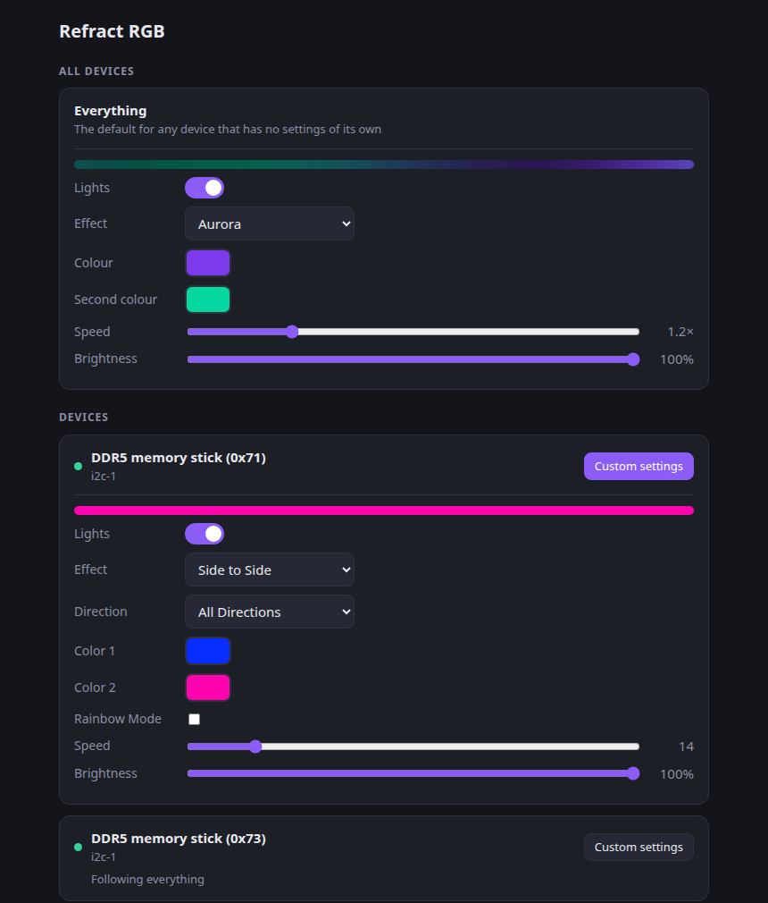

<p align="center">
  
</p>

<h1 align="center">Refract RGB</h1>

<p align="center">
  Lighting control for Linux, for the motherboard, memory, fans and peripherals that vendor software leaves behind.<br>
  It runs SignalRGB device plugins and effects natively, from one small background service.
</p>

<p align="center">
  
</p>

## Features

- **One service, every device.** Motherboard headers, DDR5 memory and USB peripherals are driven together, with a tray icon and a web interface.
- **Runs SignalRGB plugins as they are.** A sandboxed QuickJS host implements the `device` API they expect, so the existing library of device plugins works without being ported.
- **Runs SignalRGB effects.** HTML canvas effects render in a headless Chrome, and their own controls appear in the interface.
- **Eleven built-in effects.** Solid, breathing, rainbow wave, colour cycle, gradient wave, fire, sparkle, scanner, comet, aurora and plasma.
- **Control down to the zone.** Settings resolve zone, then device, then everything. Give one ARGB header its own colour and let the rest follow.
- **Remembers, and recovers.** Settings survive reboots. A device that disappears or a machine that wakes from sleep is picked up again automatically.
- **Careful with hardware.** SMBus writes are blocked from memory SPD/EEPROM space, and memory lighting is never saved to flash. USB devices behave as their SignalRGB plugin dictates.

## Requirements

- Linux with systemd, and a desktop session for the tray icon (GNOME needs the AppIndicator extension, which Ubuntu enables by default).
- [Rust](https://rustup.rs) to build it.
- `google-chrome` or `chromium`, only for SignalRGB HTML effects. Built-in effects work without it.
- A SignalRGB `Plugins/` folder for USB devices. See [Getting SignalRGB plugins](#getting-signalrgb-plugins).

## Install

```sh
git clone https://github.com/delano-git/refract-rgb
cd refract-rgb
contrib/install.sh --plugins /path/to/SignalRGB/Plugins
```

The script builds the binary, installs the udev rule, loads `i2c-dev`, adds you to `plugdev`, and starts a systemd user service. It needs `sudo` for exactly those device-access steps. Run it with `--dry-run` to see every command first. If it added you to `plugdev`, log out and back in once.

Then open **http://127.0.0.1:7878/** or click the tray icon.

<details>
<summary>Manual install</summary>

```sh
cargo build --release
install -Dm755 target/release/refract ~/.local/bin/refract

# Let your user talk to HID and SMBus devices
sudo install -Dm644 contrib/70-refract-rgb.rules /etc/udev/rules.d/70-refract-rgb.rules
sudo udevadm control --reload
sudo udevadm trigger --subsystem-match=hidraw --action=add
sudo udevadm trigger --subsystem-match=i2c-dev --action=add
echo i2c-dev | sudo tee /etc/modules-load.d/refract-rgb.conf
sudo modprobe i2c-dev
sudo usermod -aG plugdev "$USER"        # then log out and back in

# Start at login
REFRACT_PLUGINS=/path/to/SignalRGB/Plugins refract install-service
```

To remove it: `contrib/install.sh --uninstall`. Your settings in `~/.config/refract-rgb` are kept.

</details>

## Getting SignalRGB plugins

Refract RGB does not include SignalRGB's plugins or effects, which are theirs. They are plain JavaScript and HTML files, installed with SignalRGB on Windows under `Signal-x64/Plugins` and `Signal-x64/Effects`. Copy those folders somewhere on your Linux machine and point Refract RGB at the `Plugins` folder:

```sh
refract daemon --plugins /path/to/Signal-x64/Plugins
```

Effects are picked up from the `Effects` folder beside it, and from `~/.config/refract-rgb/effects/` for ones you add yourself. Without plugins, memory over SMBus and the built-in effects still work.

## Using it

**Tray icon.** The dot shows the colour your lights have right now. The menu switches effects, turns the lights off, or opens the web interface.

**Web interface.** Choose an effect and colours with the picker, then set speed and brightness. Each device has *Custom settings*, and devices that expose several zones, such as ARGB headers, list them for individual control.

**Command line.**

| Command | What it does |
| --- | --- |
| `refract daemon [--plugins DIR]` | Run the app (the service does this for you) |
| `refract apply '#rrggbb' [--dry-run]` | Set one colour on every supported device and exit |
| `refract list` | List HID devices |
| `refract i2c`, `refract i2c-scan <bus>` | List SMBus adapters; passively scan one |
| `refract info <plugin.js>` | Show a plugin's name and USB IDs |
| `refract run <plugin.js> [--live] [--color '#rrggbb']` | Drive one plugin (a dry run unless `--live`) |
| `refract sweep <plugins-dir>` | Dry-run every plugin and summarise failures |
| `refract install-service` | Start the daemon at login |

Manage the service with `systemctl --user status|restart|stop refract-rgb`. Settings live in `~/.config/refract-rgb/config.json`.

## Supported hardware

Verified on real hardware:

| Device | Notes |
| --- | --- |
| MSI Mystic Light motherboard controller (`1462:7d75`, MAG B650 Tomahawk WiFi) | Onboard LEDs and ARGB headers, including fans connected to them |
| ENE DDR5 memory RGB (`AUDA0-E6K5-0101`, Team Group modules) | Driven over SMBus, per module |

Any other device with a SignalRGB plugin should be reachable through the plugin host. A dry-run sweep of the 462 plugins in SignalRGB 2.5.80 initialises 394 cleanly, and the rest mostly need shims for host features that are not implemented yet. A dry run proves the plugin loads, not that the hardware responds, so treat other devices as untested until you have seen them light up. Reports are welcome.

## How it works

```
 plugins (JS) ──▶ QuickJS host ──▶ hidraw / SMBus ──▶ hardware
                       ▲
 effect engine ────────┤   built-in effects, plus SignalRGB HTML effects
 (zone ▸ device ▸ all) │   rendered in headless Chrome over a DevTools pipe
                       │
 tray · web UI · CLI ──┘   one daemon, settings saved as JSON
```

- Plugins sample the effect by position, much as they would sample SignalRGB's canvas, so they need no changes.
- One thread runs per device, and a supervisor restarts any that fail. A gap in frames means the machine slept, so the device is initialised again.
- The web interface binds to `127.0.0.1` only. It rejects foreign `Host` headers and requires a custom header on writes, so a web page you visit cannot change your lights.
- Chrome runs sandboxed with name resolution disabled, only while a HTML effect is showing, and exits 20 seconds after.

Notes on the plugin API are in [`docs/`](docs).

## Troubleshooting

| Symptom | Check |
| --- | --- |
| A device is listed as *error* or missing | `refract list`; `ls -l /dev/hidraw*` should show group `plugdev`, and `id` should include it |
| Memory is not found | `ls -l /dev/i2c-*` (group `plugdev`); `lsmod \| grep i2c_dev`; the DIMMs must show up as `spd5118` devices |
| No tray icon | Needs a StatusNotifier host. On GNOME, enable the *AppIndicator and KStatusNotifierItem Support* extension |
| HTML effects are missing | Install `google-chrome` or `chromium`; check that `Effects/` sits beside your `Plugins/` folder |
| Lights revert after login | `systemctl --user status refract-rgb`; `journalctl --user -u refract-rgb -b` |
| Lights do nothing until I log in | The service starts with your session. Firmware lighting shows until then |

## Development

```sh
cargo build
cargo test                    # effects, effect parser, override resolution
node tools/ui-test.mjs        # end-to-end UI test against a running daemon (Node 22, Chrome)
refract canvas-test <effects-dir> Static/Rainbow     # render an HTML effect and print colours
```

Source layout: `src/host.rs` is the plugin host, `src/fx.rs` the effects and override model, `src/engine.rs` the device supervisor, `src/canvas.rs` the Chrome host, `src/ene.rs` and `src/i2c.rs` the memory controller, and `src/web.rs`, `src/tray.rs` and `src/ui.html` the interfaces.

## Disclaimer

Refract RGB is an independent project and is not affiliated with or endorsed by SignalRGB. Controlling RGB hardware over SMBus carries inherent risk: this project blocks the memory SPD/EEPROM range and never saves memory lighting to flash, but USB plugins run as written by their authors. You use it at your own risk.
